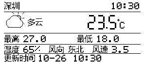
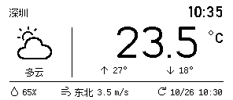
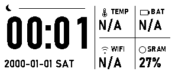
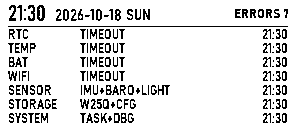
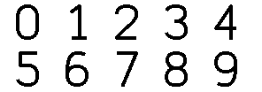

# 墨水屏显示效果优化

更新日期：2026-10-27。返回[文档导航](README.md)。本文件整理当前 GDEY029T94-FL03 的显示方法、页面评估和下一轮改动依据。接线与刷新历史见[显示移植记录](epd_gdey029t94_port.md)，现有输出契约见[界面文档](clock_gray4_ui.md)，功能进度统一见[totalPLAN.md](totalPLAN.md)。

## 当前结论

正常时钟页先保留，天气页需要按已选定的图标分栏稿修改，故障页只做字体对照后再决定。此次只更新文档并验证当前主机渲染，没有修改固件、烧录或调整屏幕参数。

| 页面或部分 | 当前情况 | 处理结论 |
| --- | --- | --- |
| 正常时钟 | 大数字固定格；日期、小字与图标已有原生实黑修复；当前 C 帧未见重叠或裁剪 | 保留布局及字形，先做当前完整镜像的实屏验收 |
| 天气页 | 仍为多行中文标签、16×30七段数字；并非已选定的图标分栏和圆弧数字 | 优先修改天气渲染器和资源 |
| 故障页 | 七类信息均可显示；错误字体和页头仍经过超采样缩小 | 保留七行三列结构，单独比较原生字号字形；目前未证明存在实屏缺陷 |
| 刷新流程 | 黑白全刷、分钟或可见变化触发、刷新中合并、BUSY 后提交 | 沿用现有流程，画质调整先集中在资源与布局 |
| 四灰阶 | 历史实屏0/2同白、1/3同黑，尚未通过验收 | 生产继续黑白，灰阶诊断独立保留 |

### 当前 C 帧与选定目标

以下图片均为296×128原尺寸。当前图来自本次工作树的 C 渲染器；天气目标为用户已选定的设计稿，尚未移植到固件。两者示例时刻不同，只用于比较布局和字形。

| 当前天气 C 帧 | 已选天气目标 |
| --- | --- |
|  |  |

| 当前正常时钟 C 帧 | 当前七类故障 C 帧 |
| --- | --- |
|  |  |

时钟图中的日期、数值和故障为测试输入，不是设备实采。图片用于检查像素，不能证明实屏对比度、墨水扩散或残影。

## 改善显示的方法

### 字形、图标和布局

| 方法 | 在本工程中的做法 | 检查方式 |
| --- | --- | --- |
| 原生尺寸设计 | 以296×128逻辑坐标排版；小字在最终字号生成，避免逐字裁切后拉伸填满方格 | 先看1×，再用最近邻2×/3×定位像素；不用平滑缩放判断清晰度 |
| 黑白笔画完整 | 生产帧最终只含黑白；小字和结构线使用实黑，避免细笔画依赖未验证的灰阶 | 独立解码 C 帧，检查0/255、断笔、内孔和线条连续性 |
| 大字单独精修 | 统一字高、笔画、底线与内部留白；针对2/3/5转折、6/8/9内孔修整；曲线可离线采样后量化 | 对照0～9及重复数字，兼看原尺寸和放大图；不只检查23.5 |
| 固定动态位置 | 使用固定数字槽位、独立负号、小数点和单位；高低温各占固定区域 | 比较9.9→10.0、正温→负温、11.1→88.8，主要锚点不移动 |
| 小字统一基线 | 数字、中文和单位使用明确基线与推进距离；字形之间至少保留1个原生像素的空白 | 检查“湛、霾、静”等密字、百分号、m/s以及最长组合 |
| 减少重复标签 | 用湿度、风、更新图标替换完整字段名；保留城市、天气描述和必要状态 | 先读出当前温度，再读高低温及底栏；单位可直接辨认 |
| 统一图标轮廓 | 天气大图标采用48×48离线位图；目标外轮廓约2px、细节1px；云与降水至少留2px | 检查太阳被云遮挡的边缘、雨雪分离和不同天气的辨识度 |
| 留出最长内容空间 | 为负温、100%、99.9m/s、双字风向、AM/PM和过期标志预留边界 | 同时组合最长字段；不能只证明每个单字段独立放得下 |

上述笔画宽度是当前选定稿的设计目标，不是所有电子纸的通用阈值。正常时钟的1px图标和细线已有完整 C 帧，先保留。若实屏确有断线，只对受影响部位做2px对照，避免统一加粗造成内孔粘连。

天气中文以已选的原生12px Fusion Pixel限定资源为目标。12px是否适合实屏仍需确认；密字难辨时先减少标签或重新分配空间，避免把字体强行压窄。40px天气数字也不直接放大成时钟数字，时钟字形应按其实际尺寸单独设计。

当前约125dpi的像素阶梯无法靠浏览器平滑消除。运行时放大、非整数缩放、灰色抗锯齿或抖动会改变像素结构，本轮不作为生产优化方案。离线生成大字曲线后输出1bpp，与实际依赖灰阶显示的抗锯齿应分开理解。

### 刷新与实屏

- 保持默认 `EPD_VENDOR_DEMO_MODE=0`、`EPD_CLOCK_USE_GRAY4=0`。当前正常按分钟全刷，天气切页和可见内容变化额外全刷；相同内容、隐藏天气更新和同一分钟只改秒不增加刷新。
- 刷新期间合并更新，控制器BUSY完成后才提交显示状态；保留完整新旧RAM写入、有限重试和控制器休眠。绘图与刷新继续由displayTask独占。
- 全刷闪烁与字形清晰度分别评价。当前生产每次全刷，驱动保留的“120次快刷/局刷后清理”不属于现行生产周期。
- 若以后减少闪烁，先在同一板卡上验证快刷/局刷、旧图基准、累计残影和清理恢复，再制定周期。不能只凭刷新更快就替换全刷路径。
- 仅当软件帧完整、实屏仍异常时，再核对供电、BUSY、初始化、接线、面板批次和环境温度。SPI提速、任意增加延时或修改LUT/VCOM没有当前证据支持，不列为默认画质修复。
- 前光控制方式尚未确认。做照片对照时固定环境光、视角和曝光，避免把照明差异当成字体改进。

### 按现象定位

| 现象 | 优先检查 |
| --- | --- |
| C 帧本身就有断笔、错位或拥挤 | 字模、裁切、基线、推进距离、坐标和帧编码 |
| C 帧正常，实屏细线缺失或内孔粘连 | 当前镜像身份、原尺寸笔画对照及实际供电/刷新状态 |
| 切页后有旧字影 | 是否完成BUSY、旧图RAM是否同步、全刷模式及连续切换后的实屏记录 |
| 画面频繁闪烁但笔画正常 | 可见变化判断、发送端重复更新和全刷触发次数 |
| 四级灰块只呈黑白 | 保留既有灰阶失败记录，按独立诊断处理，生产使用黑白 |

## 现有界面具体改哪里

### 天气页：需要修改

当前实现与目标稿的差异可以从源码和本次 C 帧复核。

| 现实现 | 修改方式 | 接入位置 |
| --- | --- | --- |
| 七段式16×30大字，温度从x180顺序推进 | 换为28×40圆弧字模，固定数字、小数点、负号及℃ | `app/epd_weather_view.c` 的 `s_large_digit()`、`s_large_temperature()` |
| 天气图标旁放描述，下方多行长标签与四条横线 | 改为左图标/短描述、右温度/高低温、底栏图标加数值 | 同文件 `s_draw()` |
| 18px微软雅黑裁切后拉伸为16×16；ASCII由5×7放大两倍 | 替换成原生字号的统一小字资源，不按字符分别拉伸 | `tools/generate_weather_glyphs.py`、`s_draw_text()` |
| 最高/最低未标度符号，风速未显示m/s | 高低温加°，风速保留m/s；精简标签同时保留单位 | `s_draw()` 及对应格式化函数 |
| 运行时绘制的细线云雨图标 | 使用已选48×48离线图标，清理太阳/云及云/降水交界 | `s_weather_icon()` 及独立天气资源表 |
| 未知与无数据均用感叹号图标 | 未知用问号，待更新用时钟；文字缩为“待更新”“过期” | 未知及无数据分支 |

主温度已能显示℃，现有测试也校验了它；需要修的是字形、锚点和其余单位。现有℃测试按不同数值断言不同位置，改版时应改为固定位置断言，避免测试继续锁定旧布局。

选定稿的主要坐标如下，后续实现以原尺寸参考图和这些锚点为准：

| 元素 | 逻辑像素位置 |
| --- | --- |
| 城市 / 小时钟 | 城市x12、基线y20；小时钟右对齐x284、顶部y8 |
| 图标 / 描述 | 48×48图标位于(20,34)；描述以x44居中、基线y96 |
| 分栏 / 底栏 | 竖线x91、y35～98；横线y104、x12～283 |
| 大数字 | 28×40，顶部y34；十位/个位/小数位x149、181、224 |
| 负号 / 小数点 / ℃ | 负号两位整数x123、一位整数x155，y52、18×4；点(213,70)、4×4；℃(265,39)、19×18 |
| 高低温 | 箭头x126、210，y84；数值x144、228，基线y94 |
| 底栏 | 湿度图标/值x12/29，风图标/风向/风速x78/95/124，更新图标/时间x200/217；文字基线y122 |

大字的原尺寸目标如下。当前温度保留一位小数，高低温为整数时省略`.0`，风速保留一位小数。℃独立绘制，不随数字位数移动。



资源改造保持现有天气协议、缓存、过期、页面选择和刷新语义。使用静态只读位图，生成器记录字体版本、输入哈希和许可。Fusion Pixel许可按OFL保留；图标若采用开源资源，应保留相应来源与许可，不能把本地重绘标为上游原图。

### 正常时钟：先保留

现有 `tools/generate_clock_assets.py` 已让DATE/LABEL/VALUE/WIFI在目标字号生成实黑字模；MAIN使用34px固定格，冒号12px，分钟位置稳定。`epd_clock_view` 已将图标和结构线分开处理。本次全天时分、日期、缺失状态和帧边界检查通过，实际原尺寸帧未发现需要重排的内容。

TEMP/BAT/WIFI当前显示N/A符合尚无数据提供者的事实，天气温度不冒充板载温度。以后若要把诊断格换成产品信息，应另行确定内容；本次不以美化为由填入虚假数值。

### 故障页：只做小范围候选

ERROR、HEADER_TIME、HEADER_DATE未包含在生成器的 `PIXEL_ALIGNED_FONTS` 中，仍经过4倍生成再缩小量化。七类故障 C 帧可读，尚无实屏证据证明它们需要替换。

下一轮可分别生成原生14px错误字、22px时间和16px日期作黑白对照。保留14px行距、七行容量和三列位置；先检查长来源组合，再决定字重。若候选更好，再补故障字库的实黑笔画与间距测试。不要直接把所有字体加粗或改变现有故障信息结构。

## 实施与验收顺序

1. 先修改天气资源和纯渲染器，保持协议及驱动；输出实际 C 帧，与相同数据的选定稿逐像素比较。
2. 覆盖深圳/湛江、全部天气码、未知/待更新/过期、静风及八风向、12/24小时制。重点组合100%、99.9m/s、−99.9℃和过期标记。
3. 检查0～9，以及11.1、47.4、0.0、9.9、−9.9、−99.9；断言固定锚点、字形底线、单位、留白、方向及缓冲哨兵。目标尺寸为4736字节1bpp原生128×296，禁止直接发送横屏PNG行序。
4. 运行天气和时钟绘制测试、资源一致性检查及显示调度回归。保留隐藏页不刷、故障覆盖、BUSY期间合并、失败不提交和天气不推进内存轮换。
5. 同步Keil源文件及资源分组，构建后记录镜像哈希、宏、Flash/RAM增量；再验证实际板卡。正常时钟只回归，故障字体候选单独比较。
6. 同镜像、同内容、同光线和视角拍摄。建议先观察30～50cm日常距离的读数，再近看断笔、内孔、分隔线和背景残影。该距离是测试建议，不是已确认的硬件指标。
7. 至少记录首次刷新、重复值不刷、跨分钟、正负温/最长值切换、天气与时钟往返、故障出现/恢复。建议室温连续观察60次分钟刷新；记录供电、环境温度、BUSY耗时、残影变化及任务栈余量。该轮次是初步验收建议，不等于寿命或低温认证。

## 本次检查记录

2026-10-27针对当前工作树重新运行以下检查，全部通过：

```powershell
.\tests\run_weather_host_tests.ps1 -OutputDirectory .\build\display-quality-20261027\weather
.\tests\run_clock_view_host_tests.ps1 -OutputDirectory .\build\display-quality-20261027\clock
python tools/generate_weather_glyphs.py --check
python tools/generate_clock_assets.py --check
```

天气覆盖协议、缓存、14种天气、极值、待更新、过期、1/2bpp及现有℃字形。时钟通过521704项绘制检查，导出17张黑白测试帧；资源检查确认时钟10180字节有效位图及现有天气中文字形一致。另用同次天气测试程序导出正负极值帧，目视普通天气、极值、正常时钟和七类故障，当前未见越界裁剪。

产物位于 `build/display-quality-20261027/`；`evidence.json`记录11个渲染、资源、模型及测试输入文件的SHA-256和上述文档图片哈希。该目录是本机辅助产物，文档中的五张原尺寸参考图独立保存在 `docs/images/`。

本轮没有重新运行显示调度集成或Keil构建，没有烧录或操作串口。此前完整镜像及25场景调度记录仍按[测试数据](测试数据.md)中的原范围保留。当前测试证明现有代码能生成有效画面，不代表已选天气目标已实现，也不证明实屏效果通过验收。
