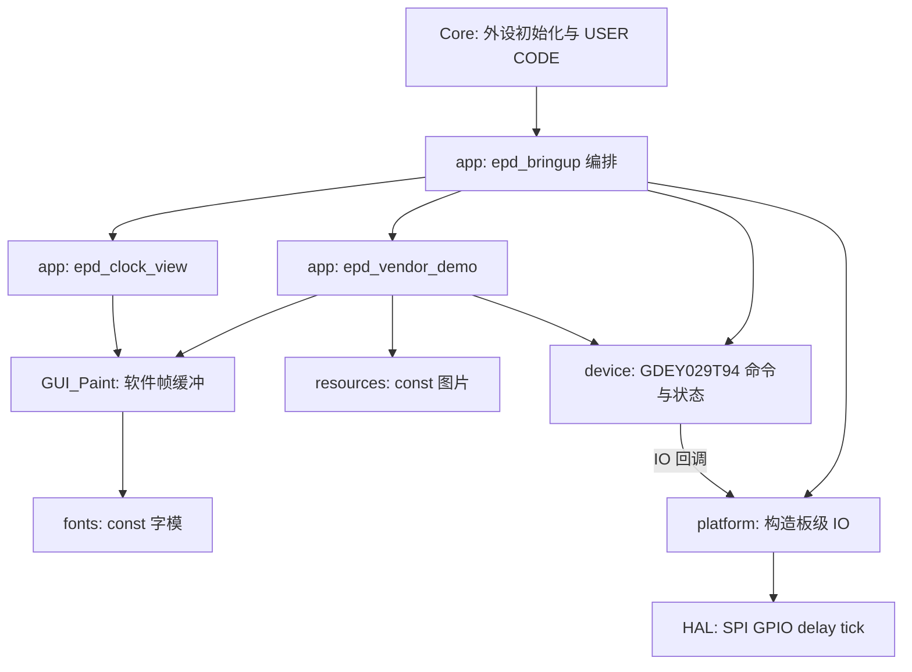

# GDEY029T94-FL03 原厂调用流程与 STM32L471 移植状态

## 1. 文档用途与当前结论

目标是把 GDEY029T94-FL03 的原厂 STM32F103 演示逻辑，迁移到 STM32L471 目标工程，并形成可维护、可超时、可诊断、可验收的驱动。

这份文档记录原厂调用流程、当前移植实现、验证证据和后续计划。旧型号 GDEY0213B74-FT11 的移植指南和驱动不再作为本屏参考实现。

截至 2026-10-09，原厂显示功能移植已完成：黑白全刷/快刷/局刷、GUI、五档完整 ASCII、两套有限中文字体、全部图片资源、四灰阶、180°初始化、342 Gate GUI，以及五窗口和独立全屏局刷演示。当前测试工程默认上电完整演示一次，清屏休眠后重新初始化 296 Gate 并进入原来的时钟。主机测试、七种 Keil 模式构建、ST-Link 下载和 Flash 读回已有记录；板上完整演示已结束并返回时钟，用户随后明确反馈“显示完全正常”。据此记录为当前板卡的显示功能实屏反馈通过；没有新增逐页照片或灰度测量，不把反馈扩大为长期可靠性、功耗、异常恢复或其他板卡兼容性验收。

本轮为准备移入主要工程，进一步按《嵌软开发规范》《IC 开发规范》复核当前源码。核心驱动、绘图和硬件访问的分工成立，但测试入口、固定板级绑定、全局画布和演示对驱动内部字段的访问仍有接入限制，不能整套原样当作产品模块。实际依赖、审查问题和迁移清单见第 8 节及 [墨水屏分层审查](墨水屏分层审查.md)。产品电源管理、DMA、异步队列和 RTOS 不在已完成范围。

本文阶段编号统一为：阶段 0 工程基线 → 阶段 1 黑白全刷 → 阶段 2 快刷与局刷 → 阶段 3 GUI 与字体 → 阶段 4 产品接入。第 11 节是各项验收检查，不是另一套阶段编号。

先把几个概念分清：

- **原厂示例**说明屏幕命令大致怎样使用。
- **编译成功**说明选中的源码可以编译和链接。
- **烧录成功**说明某个确定的镜像被写入目标板。
- **显示正常**以实物观察为依据；刷新耗时、灰度数值和电流另需测量。
- **原厂显示功能移植完成**指本次原厂功能已接入、构建、下载并取得正常显示反馈；**产品接入完成**还要求主工程调度、异常恢复和电源策略满足产品要求。

当前状态如下；历史构建记录与本次源码核对分开列出：

| 项目 | 状态 | 说明 |
| --- | --- | --- |
| 原厂 STM32F103 工程与默认调用流程 | 历史构建与复核记录 | 2026-09-24 10:36:22，0 Error，0 Warning；原厂默认全刷、快刷、局刷、清屏和深睡眠流程见第 3 节 |
| 原厂代码硬件运行 | 本次未证明 | 原厂工程构建记录不能证明实物运行 |
| STM32L471 目标工程 | 七种演示选择干净重建通过 | OFF/FULL/GRAY4/PARTIAL_TIME/PARTIAL_FULL/ROTATE_180/GUI_342 全部 0 Error、0 Warning，证据见第 1.3 节 |
| 296 Gate 黑白驱动 | 已实现并被当前工程选择 | 全刷、快刷、背景基准、局刷、参数检查、BUSY 超时和刷新统计均有源码；现存 MAP 保留时钟使用的刷新路径 |
| 方向、局刷和时钟观感 | 用户实屏反馈良好 | 以照片 1、排线在右侧为查看方向；未把这项反馈扩大为长期残影、全部边界或异常验收 |
| 时钟数字字形 | 完整 Font24 已下载，用户显示反馈正常 | 双倍绘制 `HH:MM:SS`；板上帧缓冲与独立字模参考逐字节一致 |
| 黑白 GUI 和完整 ASCII | 完整演示运行通过，用户显示反馈正常 | 五档字体与图形/数字页面已运行；既有静态诊断页独立保留 |
| 中文字体、原厂图片 | 数据核对、构建、运行及用户显示反馈通过 | 中文仅含“你好Aabc”，不是完整中文字库；图片 50,432 B |
| 四灰阶、180°、342 Gate | 命令测试、板上流程及用户显示反馈通过 | 当前板卡显示正常；没有灰度测量、逐页照片或其他屏幕批次兼容性证据 |
| 五窗口及全屏局刷演示 | 批次测试、板上计数及用户显示反馈通过 | 6 批五窗口 + 5 批整屏局刷；每五批清残影一次，与时钟 120 次策略独立 |
| 本轮完整演示下载 | 已完成、下载校验与 Flash 读回一致 | 当前默认 FULL；镜像身份见第 1.3 节；第 1.2 节保留此前纯时钟证据 |
| 深睡眠 | 演示流程已调用并返回正常 | 各演示段及最终清屏后发送 `10:01`；连续时钟仍保持唤醒，未测睡眠电流 |
| 故障恢复与产品低功耗 | 演示错误有一次恢复；产品部分待完成 | IO/BUSY 失败使设备失效；演示停止并尝试一次 BW296 初始化；时钟运行错误保留状态后停机；无电源控制回调 |
| 分层及主要工程接入 | 核心分层成立，存在接入整改项 | 测试入口永久循环、板级资源固定、Paint 全局单例；主工程尚未接入或构建，见第 8 节 |

### 1.1 本次核对的工作区与镜像

- 核对日期：2026-10-09。
- 实际工作区和 Git 根目录：`D:/codeOfVSCODE/desk clock`。
- 分支：`EinKTest`；本轮实际 `HEAD`：`9d2f0be8f372c548ff549d870362245eaec1edcf`；审核基线为 `HEAD`。
- 本轮核对既有应用、驱动、平台、Keil 配置及历史构建证据，并在此基础上新增 GUI、字体与时钟视图。执行开始时 `git status` 无改动；随后实施及构建生成的源码、工程设置和产物变化均保留，不回退无关文件。原有构建产物在重建前已备份。
- 构建选择：`elinkTest/MDK-ARM/elinkTest.uvprojx`，目标 `elinkTest`，MCU `STM32L471RETx`；`.ioc` 的订货型号为 `STM32L471RET6`。
- 本轮实际完成修改、两种模式干净构建、主机测试和默认时钟 ST-Link 下载；结果见第 1.2 节。以下表格保留历史镜像身份，不以旧哈希证明新增 GUI 已进入固件。

历史目标工程产物如下，已备份到 `docs/evidence/gui-port-20261009/historical-20261002/`。时间来自文件记录，成功结果来自旧构建日志：

| 产物 | 时间 | SHA-256 |
| --- | --- | --- |
| `elinkTest/MDK-ARM/elinkTest/elinkTest.axf` | 2026-10-02 22:33:11 | `3A69A45D38EC1677A883DFF9215C12974B8DFE8C2C5FAD48E48049752F39E85B` |
| `elinkTest/MDK-ARM/elinkTest/elinkTest.hex` | 2026-10-02 22:33:11 | `C3CCB0BD70468651A8E90023743939E9F5C5590B16D89B5B2281E0778E266B03` |
| `elinkTest/MDK-ARM/elinkTest/elinkTest.map` | 2026-10-02 22:33:11 | `57E82046447C77C9D8FFE526EA71950B94C520CA0DF6CE2D26A1C6E93621F2DB` |

旧构建日志记录 ARM Compiler 5.06 update 7 build 960、`Code=14012`、`RO-data=1120`、`RW-data=24`、`ZI-data=12176`。这是历史增量构建证据，不能称为本轮干净重建。用户此前确认重新下载过固件，但未把历史 HEX 哈希绑定到实板；此前实屏反馈与旧镜像的身份链仍不完整。

### 1.2 2026-10-09 GUI 移植构建、测试与下载证据

本轮证据位于 [evidence/gui-port-20261009](evidence/gui-port-20261009/)。Keil 目标仍为 `elinkTest`，编译器为 ARM Compiler 5.06 update 7 build 960。使用 Rebuild 分别构建 GUI 验收页与默认时钟，均记录 `0 Error(s), 0 Warning(s)`；最终源码的 `EPD_GUI_DEMO`、`EPD_CLOCK_DIAGNOSTIC_PATTERN`、`EPD_CLOCK_DIAGNOSTIC_FORCE_FULL` 均为 `0U`，清残影阈值仍为 `120U`。

| 模式 | 产物时间 | Code | RO-data | RW-data | ZI-data | ROM | RAM | 下载状态 |
| --- | --- | --- | --- | --- | --- | --- | --- | --- |
| GUI 验收页 | 2026-10-09 15:06:54 | 14,570 | 16,142 | 24 | 11,616 | 30,736 | 11,640 | 只构建，未烧录 |
| 默认时钟 | AXF/MAP 2026-10-09 15:08:59；HEX 15:09:00 | 14,646 | 7,370 | 24 | 12,088 | 22,040 | 12,112 | 15:14:18 Keil ST-Link 下载并校验成功 |

ROM 为 Code + RO-data + RW-data，RAM 为 RW-data + ZI-data。默认时钟比历史基线 ROM 增加 6,884 字节、RAM 减少 88 字节；该对比仅说明链接占用，不代表产品功耗降低。

| 归档产物 | SHA-256 |
| --- | --- |
| `clock/elinkTest.axf` | `D973FC7FD58E124D6483AE3E32940D34B3D57A29C3E3FAFEE144B247B9A09BBF` |
| `clock/elinkTest.hex` | `DEDBEB42DF9C547040E7C43C42C84ECEC7004AF06AD394F62349D3BC65DA3738` |
| `clock/elinkTest.map` | `B881C88A4A4577C55B05C2E89C3C05B4BD080D14374F117530D65A25E613E2C6` |
| `demo/elinkTest.axf` | `ACF8B1BB9790EE412ED0C88124521CC89AE416578CD2369C04242648B5CCB5E8` |
| `demo/elinkTest.hex` | `AFA27B9984DE33F8D7F4A41B1E2237B9BCFBB36105478AB95F8C9BCBCB6AE116` |
| `demo/elinkTest.map` | `5F251C9F3CE13DABAAAB0CF01741008CD35C7499CAE96D95363C7D929AD06589` |

镜像选择由完整 MAP 核实，不从未裁剪的交叉引用误判：GUI 验收页最终符号表包含五档字模 15,580 字节和五个只读描述共 40 字节；默认时钟只保留 Font24 字模 6,840 字节和 8 字节描述，秒窗口为 476 字节、`Paint` 状态为 24 字节。全部五个源文件进入编译，不意味着全部五档字体都会留在默认时钟镜像。

主机 C99 测试使用 `-Wall -Wextra -Werror -pedantic -O2`，`host-test.log` 记录 294,134 项检查通过，覆盖哨兵、坐标变换、图形、475 个 ASCII 字模、缩放、字符串、有符号数字、时间和 476 字节秒窗口。8 种模式组合中 4 种有效组合通过、4 种冲突组合按预期触发编译错误。`host/` 保存时钟、GUI 和方向图 BMP，软件预览已检查可读且没有内容重叠；预览不是真实屏幕照片。

可从仓库根目录复跑主机测试：`.\elinkTest\tests\run_gui_host_tests.ps1 -OutputDirectory <tempdir>`，将 `<tempdir>` 替换为测试输出目录。

`clock-flash.log` 原文为 `Load "elinkTest\\elinkTest.axf"`，随后 `Erase Done.Programming Done.Verify OK.Flash Load finished at 15:14:18`，记录下载进程退出码为 0。本轮下载的是默认时钟 AXF，不是只构建的静态验收页。

下载后使用 STM32CubeProgrammer 2.22.0 只读导出 Flash `0x08000000` 起的 22,040 字节，与该 AXF 经 fromelf 导出的 `clock/elinkTest.bin` 比较，两个文件 SHA-256 完全一致：`35F12390640F55DD30FAB4D60E57481202BBE581D8364BCD2A1E45A9B4B28314`。读取与复位日志识别 ST-Link 序列号 `37FF71064E57343617CE1A43`、固件 `V2J46S7`，目标电压 3.29 V、Device ID `0x415`、Rev 4、Flash 512 KiB。该读回把本轮镜像绑定到此连接目标。

下载后首次读取的状态/统计值不支持判断时钟已正确启动，保存为 `runtime-first.log`。随后明确执行软件复位（`clock-reset.log`）并再次读取，`runtime-after-reset.log` 显示状态为 `0/OK`、累计全刷 1 次、快刷 1 次、局刷 48 次、距上次全刷计数 49，内核运行且 PC 为 `0x08001E76`。这是本轮时钟刷新路径已经运行的统计证据，不能代替刷新区域、字形或残影的视觉验收。

后续 `runtime-frame-snapshot.log` 的累计统计为全刷 1、快刷 2、局刷 114、距全刷计数 116；`runtime-cleanup.log` 显示状态 `0/OK`、内核运行、全刷 7、快刷 14、局刷 787、距全刷计数 81。成功快刷/局刷合计 `14+787=801=6×120+81`，与首帧一次全刷加六轮清残影全刷相符；已超过至少 130 次成功更新的统计目标。样本间隔较长，不由此推断每秒精确刷新时长，也不将累加计数当作字形和残影通过。

板上只读导出的 `clock/target-frame.bin` 经独立 Font24 参考绘制器比较，全部 4736 字节一致，唯一匹配时间为 `00:32:29`，结果见 [target-frame-test.log](evidence/gui-port-20261009/clock/target-frame-test.log)。对应 [target-frame.bmp](evidence/gui-port-20261009/clock/target-frame.bmp) 已检查可读；这是 MCU 软件帧缓冲的离线一致性证据，仍不是墨水屏实际显示照片。

历史证据边界：这一轮 GUI 构建记录本身没有实屏照片、逐次视觉观测、BUSY 时序、逻辑分析仪或电流测量。后续完整演示及用户“显示完全正常”的反馈见第 1.3 节，更新显示结论，但没有补齐时序或电流测量。另一次 CubeProgrammer 单独调用 verify 的尝试返回命令用法错误，保存于 `clock-target-verify.log`，不能将其当作第二份校验成功；已确认的校验证据是 Keil 的 `Verify OK` 和上述 Flash 读回一致。

### 1.3 2026-10-09 剩余原厂显示功能实施证据

本次在既有脏工作树上继续开发，保留先前 GUI/时钟及工程用户改动。实施前的 AXF/HEX/MAP 和调用图归档到 [vendor-port-20261009/baseline](evidence/vendor-port-20261009/baseline/)，原时钟 HEX SHA-256 为 `DEDBEB42DF9C547040E7C43C42C84ECEC7004AF06AD394F62349D3BC65DA3738`。本节是最新状态，第 1.1/1.2 节保留前一轮记录。

新证据目录：[evidence/vendor-port-20261009](evidence/vendor-port-20261009/)。完整演示默认宏为 `EPD_VENDOR_DEMO_FULL`，三个既有诊断开关均为 0。Keil/ARMCC 版本、目标型号和引脚配置保持原样。

| 模式 | ROM/B | RAM/B | 构建 | 下载 |
| --- | ---: | ---: | --- | --- |
| OFF，纯时钟回归 | 22,800 | 12,120 | 0 错误、0 警告 | 只构建，没有覆盖当前板上完整演示 |
| FULL，默认完整演示 | 87,632 | 22,888 | 0 错误、0 警告 | 已下载、校验、复位及读回 |
| GRAY4 | 33,136 | 21,608 | 0 错误、0 警告 | 未单独下载 |
| PARTIAL_TIME | 31,188 | 13,416 | 0 错误、0 警告 | 未单独下载 |
| PARTIAL_FULL | 56,092 | 12,136 | 0 错误、0 警告 | 未单独下载 |
| ROTATE_180 | 28,336 | 12,136 | 0 错误、0 警告 | 未单独下载 |
| GUI_342 | 36,232 | 12,136 | 0 错误、0 警告 | 未单独下载 |

ROM=Code+RO-data+RW-data，RAM=RW-data+ZI-data，包含工程配置的栈和堆。完整模式详细值为 Code=18,952、RO-data=68,656、RW-data=24、ZI-data=22,864。RAM 远低于 96 KiB SRAM1，Flash 远低于 512 KiB。调用图报告最大静态链 504 B，另外有未跟踪函数指针；仍使用 1,024 B 栈、512 B 堆，无大帧栈数组或 malloc，未将静态调用图当作实测栈高水位。

`full/elinkTest.map` 的最终符号表含全部 50,432 B 原厂资源、Font12CN/Font24CN（各 996 B 表+12 B 描述）、五档 ASCII；`gray_work` 9,472 B 和 `patches` 1,280 B 为静态 RAM。OFF 模式没有灰阶工作缓冲。中文 Font12 原始矩阵仅 42 B/条，按原厂结构补齐至 164 B，所以实际 Flash 字模占用比原始有效矩阵 1,236 B 更大。

实际下载的 `full/elinkTest.hex` SHA-256：

```text
ACBCBB57AB248CEA51E93D71F669D639EF491817C765A0650A80D4BDC6BB75BF
```

`full-flash.log` 记录 STM32CubeProgrammer 2.22.0、ST-Link `37FF71064E57343617CE1A43`、目标 Device ID `0x415`/Rev 4/512 KiB、3.30 V，擦除对应 0..42 扇区，写入 `0x08000000` 起 87,632 B 后 `Download verified successfully`。没有全片擦除无关 Flash。随后读回同一区间，`full/elinkTest.bin` 与 `full/flash-readback.bin` 完全一致，两者 SHA-256 为：

```text
370E4FDB08A71BB3419E88BBC01868E8E4FA121FE24D54A8BAE4FC5BF422BFD3
```

`full-reset.log` 记录显式软件复位和 run。`runtime-first.log` 在 stage=5 时读到 completed_pages=3、completed_batches=11；`runtime-complete.log` 读到：stage=14、pages=12、batches=11、cleanup_refreshes=2、status=0、completed=1、recovered_to_clock=0。累计全刷 16、快刷 2、局刷 65、距全刷 55，符合演示 15 次全刷/1 次快刷/11 批局刷，随后时钟首帧及动态刷新。计数来自 MCU 状态，不是逻辑分析仪命令捕获。

累计统计跨 `init_profile()` 保留，传统 `init()` 仍重置对象和累计统计。`source-hashes.csv` 记录本轮应用/设备/GUI/中文/资源/工程源文件身份；原启动生成代码、SPI、GPIO、RTC 和外设配置均未修改。

`runtime-clock-frame.log` 导出当前时钟 RAM，统计已到全刷 16、快刷 2、局刷 96、距全刷 86，状态 OK。[target-clock-test.log](evidence/vendor-port-20261009/target-clock-test.log) 独立解码为 `01:14:58`，全部 4,736 B 与原 Font24 双倍参考一致。

`host-test.log` 的 616,084 项检查涵盖四种初始化精确命令、65,536 双字节组合的两灰阶平面、SPI/BUSY 故障停止、快刷/局刷故障、资源像素变换、中文六条目、帧缓冲哨兵、五窗口单次激活、完整演示和模式切换；72 种模式组合包含错误选择及诊断冲突。`clock-host-test.log` 保留既有 294,134 项 GUI/时钟检查，均通过。导入核对保证原厂数组、索引、矩阵和注释可重复生成。

`runtime-clock-regression.log` 随后读到全刷 21、快刷 13、局刷 708、距全刷 109、状态 OK，演示状态仍 completed=1/recovered=0。扣除演示 1 次快刷和 11 批局刷，时钟成功快/局刷为 `(13-1)+(708-11)=709=5×120+109`；全刷为演示 15+时钟首帧 1+周期 5=21。证明返回时钟后的计数与 120 次策略一致，不证明每秒精确时序或残影视觉通过。

`host/` 的 PNG 是软件预览：原厂图片和四级条带按照片 1 坐标解码；GUI PNG 按 `ROTATE_270 + MIRROR_NONE` 软件逻辑画布解码，不模拟 342 Gate 的额外 46 行。完整演示下载后，用户在本会话明确反馈“显示完全正常”。当前状态更新为“源码已移植、主机及构建通过、已烧录、板上流程运行通过、用户实屏显示反馈通过”。反馈覆盖已运行演示的总体观感；未取得新增逐页屏幕照片、四级亮度数值或长时间残影记录，不声称逐项测量完成，也不推广到其他板卡或屏幕批次。

本轮分层审查再次执行 `import_vendor_data.ps1 -VerifyOnly`，资源、中文索引、矩阵和原厂注释一致；`source-hashes.csv` 的 16 个源码/工程文件哈希全部匹配。归档 HEX 哈希及 BIN/Flash 读回哈希也再次匹配。本轮只审查和更新文档，没有修改固件源码、重建或再次下载；上述构建与运行数据来自既有归档，主要工程尚未验收。

复跑命令（从仓库根目录，PowerShell）：

```powershell
.\elinkTest\tests\run_vendor_host_tests.ps1 -OutputDirectory <测试目录>
.\elinkTest\tests\run_gui_host_tests.ps1 -OutputDirectory <测试目录>
.\elinkTest\tests\build_vendor_modes.ps1 -OutputDirectory <证据目录>
.\elinkTest\tests\render_vendor_previews.ps1 -Directory <原厂测试输出目录>
```

构建脚本为七种选择创建临时 Keil 工程并分别保存产物，保留本测试工程 FULL 默认值；仅移除当次创建的临时工程文件。原完整演示固件仍留在板上，OFF 仅用于构建和主机回归。

## 2. 已确认的原厂构建基线

原厂工程位置：

```text
S-GDEY029T94-FL03原厂实例代码/
  S-GDEY029T94-FL03/S-GDEY029T94/S-GDEY029T94/
  S-GDEY029T94-FP4G-20250210/
```

构建工具与结果：

- Keil uVision 5.43.1
- ARM Compiler 5.06 update 7 build 960
- 目标 `Target 1`
- Code：7096 bytes
- RO-data：50768 bytes
- RW-data：52 bytes
- ZI-data：1836 bytes
- 结果：`0 Error(s), 0 Warning(s)`

原厂历史构建产物：

| 产物             | 时间                | SHA-256                                                              |
| ---------------- | ------------------- | -------------------------------------------------------------------- |
| `OBJ/EPD.axf`  | 2026-09-24 10:36:22 | `6F724BEAFA224C741C149D8D1EA67469F2117CCCAAD8B3BD384D6922CA74320C` |
| `OBJ/EPD.hex`  | 2026-09-24 10:36:22 | `9BB6091AF11D4F7307A4EC486D0F66BC957D3981D539C3180E8231E3A068AC29` |
| `USER/EPD.map` | 2026-09-24 10:36:22 | `2BCF0ACEF2BAAF01A4553BBC0101F7CB6482F5A8A4814754E45E6FC79D0A09C1` |

`SYSTEM/usart/usart.c` 中的 `_sys_exit()` 已改为合法的 `void` 实现：

```c
void _sys_exit(int x)
{
    (void)x;
}
```

因此，之前“原厂工程无法编译”的判断已由该次成功构建纠正。这些产物能证明对应历史构建，不能证明此后工作树修改或本轮目标板 GUI 实施。

## 3. 原厂默认程序到底做了什么

### 3.1 从最外层看

`main()` 先完成延时、中断分组和屏幕 GPIO 初始化，然后只运行一轮演示：

```text
启动
  -> GPIO 初始化
  -> 黑白全刷一张图
  -> 深睡眠
  -> 快刷第二张图
  -> 深睡眠
  -> 写入局刷背景图
  -> 执行 6 次时钟数字局刷
  -> 深睡眠
  -> 全屏清白
  -> 深睡眠
  -> 永久停在 while(1)
```

AXF 反汇编和链接调用图确认最终镜像中的默认调用顺序为：

```text
EPD_HW_Init
EPD_WhiteScreen_ALL(gImage_1)
EPD_DeepSleep

EPD_HW_Init_Fast
EPD_WhiteScreen_ALL_Fast(gImage_2)
EPD_DeepSleep

EPD_HW_Init
EPD_SetRAMValue_BaseMap(gImage_basemap)
EPD_Dis_Part_Time(...) x 6
EPD_DeepSleep

EPD_HW_Init
EPD_WhiteScreen_White
EPD_DeepSleep
永久循环
```

四灰阶、GUI、180 度显示和全屏局刷演示由 `#if 0` 关闭，不属于默认运行路径。

### 3.2 一次刷新的基本结构

无论全刷、快刷还是局刷，都可以拆成五步：

1. 复位屏幕。
2. 写控制器初始化寄存器。
3. 把图像数据写入控制器 RAM。
4. 发送刷新命令并等待 BUSY 结束。
5. 发送深睡眠命令。

最重要的区别是更新控制值：

| 模式     | `0x22` 数据 | 随后命令 |
| -------- | ------------- | -------- |
| 黑白全刷 | `0xF7`      | `0x20` |
| 快刷     | `0xC7`      | `0x20` |
| 局刷     | `0xFF`      | `0x20` |

深睡眠使用：

```text
命令 0x10
数据 0x01
```

### 3.3 显存和坐标

屏幕物理分辨率是 296 x 128。原厂驱动按控制器 RAM 的方向定义：

```text
X：128 像素，也就是每行 16 字节
Y：296 行，地址 0 到 295
单色全屏缓冲区：128 / 8 x 296 = 4736 字节
```

正常黑白初始化中的关键参数为：

| 命令     | 数据                       | 含义                       |
| -------- | -------------------------- | -------------------------- |
| `0x01` | `0x27, 0x01, 0x00`       | 296 条 Gate 线，末地址 295 |
| `0x11` | `0x01`                   | RAM 数据进入方向           |
| `0x44` | `0x00, 0x0F`             | X 地址范围 0 到 15 字节    |
| `0x45` | `0x27, 0x01, 0x00, 0x00` | Y 地址范围 295 到 0        |
| `0x4E` | `0x00`                   | 当前 X 地址                |
| `0x4F` | `0x27, 0x01`             | 当前 Y 地址 295            |

### 3.4 SPI 和 BUSY

目标接口要求：

- 四线 SPI
- 8 位数据
- MSB first
- SPI Mode 0
- 写入时钟不高于数据手册给出的 20 MHz 上限
- BUSY 高电平表示忙，低电平表示可继续
- CS 低有效
- D/C 低表示命令，高表示数据
- RESET 低有效

原厂例程使用 GPIO 模拟 SPI。移植时只保留“命令、数据和时序语义”，不复制 STM32F103 GPIO 宏和空循环延时。

## 4. 对之前代码判断的修正

以下旧结论应撤回：

1. **“工程无法编译”已不成立。** `_sys_exit()` 修复后已有同一时间生成的成功构建记录和产物。
2. **对应构建的镜像身份可追溯。** 产物时间、构建日志和哈希能够对应起来；历史产物仍不能替代当前修改后的重建证据。
3. **不能根据 MAP 中一小段交叉引用，判断 `main()` 只链接了第一项显示操作。** AXF 反汇编和完整调用图已经证明默认全刷、快刷、局刷和清屏路径都存在。

这次修正只影响构建和链接判断。它不等于原厂程序已在实物上验证，也不消除下面的源码风险。

## 5. 原厂源码风险与当前移植处理

本节分析原厂 F103 示例；无限 BUSY、窗口未校验和 GUI 越界不是当前 L471 驱动的未修复结论。当前处理结果分别列在对应小节，主要工程接入风险见第 8 节。

### 5.1 BUSY 可能永久卡住

`Epaper_READBUSY()` 使用无限循环，没有超时。如果屏幕未上电、BUSY 接错、控制器异常或电平一直为高，程序会永远停住。

当前处理：设备层使用毫秒时基和 10,000 ms 超时，超时返回 `ERROR_BUSY_TIMEOUT` 并标记设备失效。调用者仍须保证 tick 持续推进；关中断或停时基调用不能保证退出。

### 5.2 局刷输入没有边界检查

原厂局刷接口没有完整检查：

- 坐标是否在屏幕内
- 宽高是否为零
- X 是否满足字节对齐要求
- `x + width`、`y + height` 是否越界
- 宽高乘法是否溢出
- 图像缓冲区长度是否足够

当前处理：局刷及批量局刷在 IO 前检查非空、宽高、范围、X/width 字节对齐和严格长度；批量额外检查最多五窗、不重叠及源缓冲不与设备对象别名。非法输入不触发 SPI。

### 5.3 `y_start == 0` 会下溢

`EPD_Dis_Part_RAM()` 中存在：

```c
y_start = y_start - 1;
```

如果传入 0，无符号坐标会下溢。当前新驱动没有照搬该减一：窗口校验后按 `295-y` 和 `296-y-height` 计算控制器地址，`y=0` 的合法窗口可正常发送。

### 5.4 GUI 初始化的 Gate 数异常

`EPD_HW_Init_GUI()` 使用 `EPD_HEIGHT + 46`，也就是 342 条 Gate 线；屏幕正常 MUX 是 296。当前没有足够证据解释这 46 行的用途。

历史处理方式是首轮不实现该路径。当前已作为独立 `EPD_PROFILE_GUI_342` 移植，保持原厂 Gate/counter 配置，软件仍为 296 行；命令测试和当前板卡的用户正常显示反馈已通过。额外 46 Gate 的物理原因仍未取得数据手册或厂家解释，不能把此配置推广到普通时钟或其他屏幕。

### 5.5 GUI 边界判断有越界风险

原厂 `GUI_Paint.c` 使用：

```c
if (X > Paint.WidthMemory || Y > Paint.HeightMemory)
```

有效下标的上限应是 `WidthMemory - 1` 和 `HeightMemory - 1`。当前 GUI 已使用 `>=` 并在旋转/镜像后再次校验原生范围，图形和文本按画布裁剪；主机有哨兵测试。调用者仍须按画布几何分配足够容量，GUI 接口没有缓冲长度参数。

### 5.6 演示程序不是产品任务

原厂 `main()` 演示一次后永久停止。它没有电源域管理、超时上报、重试策略、业务刷新调度或低功耗任务协作。它只能作为协议参考。

## 6. 移植范围和优先级

### 阶段 0：工程基线

目标 CubeMX 与 Keil 工程已存在，不需要恢复或新建。保留当前软件引脚绑定、既有构建产物及用户改动；核对工具链和镜像身份，硬件测量未完成的项目继续登记为待验证。详细基线见第 7 节。

### 阶段 1：黑白全刷和休眠

必须完成：

- 硬件复位
- 黑白正常初始化
- 写入 4736 字节全屏缓冲区
- 全屏刷新
- BUSY 超时
- 深睡眠
- 错误码和最小日志

先用固定黑白棋盘格、边框、四角标记和方向标记验证坐标。暂时不接业务 UI。

### 阶段 2：快刷和局刷

在第一阶段稳定后增加：

- 快刷初始化和刷新
- 局刷窗口设置
- 背景 RAM 建立
- 坐标、对齐和缓冲区长度检查
- 局刷次数统计
- 原厂演示约 5 次快刷或局刷后安排一次全刷，清理残影；连续时钟默认使用 120 次阈值，将清残影全刷频率降低到通常约每两分钟一次，仍会出现整屏闪烁

“约 5 次”来自原厂示例策略。连续时钟的默认值由
`EPD_GDEY029T94_CLEANUP_INTERVAL` 控制，当前工程默认 `120U`，通常对应时钟运行约两分钟；它是成功快刷/局刷次数，不是毫秒时间。若残影明显，可通过构建参数改为 `60U` 或 `30U`；若更重视观感，可暂时提高到 `180U`，但必须同步观察残影。

### 阶段 3：GUI、字体与原厂剩余显示功能（已完成，用户显示反馈通过）

绘图与屏幕初始化分层：在同一个 4736 字节单色帧缓冲上接入 GUI、五档 ASCII 和两套有限中文字体。默认完整演示一次后运行时钟；静态诊断页独立保留。设备层增加 profile、灰阶和批量局刷，时钟维持已验证的 296 Gate 命令路径。接口、布局和验收方式见第 6.4/6.5 节，当前证据见第 1.3 节。

### 阶段 4：产品接入（后续）

产品页面、屏幕电源域、低功耗、故障恢复与非阻塞调度在 GUI 验收后独立实施，不把连续时钟演示等同于产品低功耗完成。

### 剩余范围

中文资源、图片、四灰阶、180°、全屏局刷和 342 Gate 已按第 6.5 节移植，并取得用户正常显示反馈。剩余工作是主要工程接入和产品验证，见第 8 节；DMA、异步队列、复杂刷新调度、RTOS 和新的低功耗策略仍未实施。

### 6.1 照片方向定位与当前代码修正

本次实物照片以照片 1 为正常查看方向，屏幕排线在右侧。照片 2 是把屏幕在面内机械旋转 180 度后的结果，不能用来替代软件坐标验证。

照片、用户运行观察和源码共同支持以下定位；未经逻辑分析仪捕获的内容仍是源码判断：

- 右侧数字持续变化，说明逻辑左右顺序正确，秒位仍在右侧；当前不是整幅图水平镜像。
- 用户观察到数字 `4` 上下倒置，结合左右顺序定位为上下镜像；软件修正后用户确认方向正常。机械旋转不能代替软件坐标修正。
- 帧缓冲区源码使用 MSB-first 位打包，与原厂 `Paint_SetPixel()` 一致；目前没有单字节 bit-reverse 错误的证据，仍需跨字节测试图验收。
- `main.c` 调用 `epd_bringup_run_clock()` 后，首帧全刷、后续秒变化进入局刷，因而“4 到 2 乱飞”必须与静态坐标错误分开验证。

原来的逻辑到物理映射是：

```c
physical_x = logical_y;
physical_y = 295 - logical_x;
```

它等价于原厂 GUI 的 `ROTATE_270`。目标驱动采用的是普通 296 Gate 初始化，因此当前应用层增加对原生 128 像素轴的镜像，修正为：

```c
physical_x = 127 - logical_y;
physical_y = 295 - logical_x;
```

这次修正不改变 `0x11`、`0x44`、`0x45`、`0x4E`、`0x4F`，也不启用 `EPD_HW_Init_180()` 或 `EPD_HEIGHT + 46` 的 342 Gate GUI 路径。180 度初始化必须和完整的 RAM 窗口、计数器及数据进入方向成套验证，不能用来替代单轴坐标修正。

秒区局刷窗口也必须跟随同一变换。历史数字子集使用物理 `x=40,width=56,y=8,height=84`；本轮完整 Font24 双倍字元改用 `(x=32,y=12,width=56,height=68)`，覆盖字元白底及笔画，并满足 8 像素字节对齐。

应用层保留方向和强制全刷诊断开关，第三阶段新增 GUI 静态验收开关（定义在 `elinkTest/app/epd_bringup.h`）：

```c
#define EPD_CLOCK_DIAGNOSTIC_PATTERN 0U
#define EPD_CLOCK_DIAGNOSTIC_FORCE_FULL 0U
#define EPD_GUI_DEMO 0U
```

正常运行三者均为 `0`，完整演示结束后的时钟使用首帧全刷、秒级局刷和分钟快刷；需要隔离局刷残影时，先把 `EPD_VENDOR_DEMO_MODE=EPD_VENDOR_DEMO_OFF`，再将 `EPD_CLOCK_DIAGNOSTIC_FORCE_FULL` 临时置为 `1`，每秒整屏刷新。方向检查用 `EPD_CLOCK_DIAGNOSTIC_PATTERN=1`；静态 GUI 验收用 `EPD_GUI_DEMO=1`。诊断三者只能选择一个，并要求原厂演示 OFF，冲突时报编译错误；修改后须重新编译下载。

方向验收图必须包含：四角不同形状、非对称箭头和 `0123456789`。照片 1 方向下的通过条件是：顶部/底部不交换，左右不交换，数字顺序可读，`4` 不倒置，且没有字节内局部镜像。

动态验收至少覆盖 `3->4`、`4->5`、`4->2`、`9->0` 和分钟进位。若强制全刷时画面稳定而局刷时出现残影，再单独检查局刷窗口地址、数据行序、`0x24/0x26` 背景基准以及 `0x22=0xFF` 更新流程。

### 6.2 频繁全刷的代码证据

当前源码可解释此前频繁整屏闪烁：清残影计数达到阈值时会触发全刷。此判断来自下列调用链，未将其当作现场 SPI 命令捕获结果：

1. `epd_bringup_run_clock()` 首次显示调用 `epd_clock_set_background()`，这只产生一次首帧全刷。
2. 同一分钟的秒变化调用 `epd_clock_partial_refresh()`，设备层将 `refreshes_since_full` 加一。
3. 当计数达到 `EPD_GDEY029T94_CLEANUP_INTERVAL` 时，局刷函数立即使用保存的完整背景图调用 `epd_gdey029t94_full_refresh()`。
4. 分钟变化调用快刷，快刷也共享同一计数器；因此阈值不能按“调用次数”误认为只影响局刷。

此前阈值为 `5U`，源码预期序列为“首帧全刷、4 次局刷、第 5 次后全刷”，通常约每 5 秒重复；随后改为 `30U`，用户仍觉得闪烁明显，因此默认改为 `120U`。本轮保留该阈值及刷新策略，诊断强制全刷默认关闭。若现场仍每秒整屏刷新，应先核对烧录 HEX 身份和编译宏，不能直接归因于 GUI 字体。

### 6.3 全刷间隔配置与历史数字子集

全刷清残影阈值位于：

```text
elinkTest/device/epd_gdey029t94.h
    EPD_GDEY029T94_CLEANUP_INTERVAL    120U
```

它统计成功的快刷和局刷次数。时钟每秒只改变秒区时，通常一次局刷对应一秒；分钟变化走一次整帧快刷，也会计入同一个计数器。首帧 `epd_gdey029t94_set_background()` 为建立 `0x24/0x26` 基准而执行的全刷不受该阈值控制。

2026-10-02 历史基线不再使用原先的 5×7 手写字模，而在应用层采用以下数字子集参数。本轮 GUI 接入已移除这份专用表，完整字体配置见第 6.4 节：

```text
elinkTest/app/epd_bringup.c
    EPD_CLOCK_GLYPH_W       11U
    EPD_CLOCK_GLYPH_H       15U
    EPD_CLOCK_SCALE         3U
```

历史字形数据取自原厂 `HARDWARE/Fonts/font24.c` 的 0 到 9，裁掉外围空白边后按 3 倍放大。它只证明复用了十个数字，不能称为完整原厂字体或 GUI 已移植。方向映射保持：

```c
physical_x = 127 - logical_y;
physical_y = 295 - logical_x;
```

历史秒区为 `x=40,width=56,y=8,height=84`；本轮调整字元布局及窗口，不改变设备层接口或初始化寄存器。

### 6.4 黑白 GUI 与完整 ASCII 的实施说明

本节保留前一轮黑白 GUI 实现说明。第 1.2 节的独立静态验收固件只构建未烧录；后续 FULL 已实际运行 GUI 页面并取得用户正常显示反馈，最新证据见第 1.3 节。刷新时序仍没有仪器测量。

#### 绘图库、字体与调用流程

GUI 位于 `elinkTest/gui/GUI_Paint.c/.h`，字体位于 `elinkTest/fonts/`，来源为原厂 `HARDWARE/GUI`、`HARDWARE/Fonts`，保留原文件已有的来源和注释；不补造原文件没有的许可声明。五档 `Font8/Font12/Font16/Font20/Font24` 均覆盖 ASCII `0x20..0x7E`，字模位图合计 15,580 字节，字模和 `sFONT` 描述使用 `const` 放入只读 Flash。默认时钟只引用 Font24，链接器可以移除未用的小号字体；GUI 验收页引用全部五档。是否实际进入镜像以对应模式 MAP 为准。

原厂中文表的实际覆盖仅有“你好”和 `Aabc`，不是通用中文库；第 6.5 节已增加显式长度 GB2312 接口。不能把 UTF-8 文本传给 ASCII 或中文接口后期待自动转换。四灰阶、342 Gate、硬件 180°的独立实现见第 6.5 节；DMA 和异步队列仍不在范围。

```text
main -> epd_bringup_run_clock
  -> epd_clock_view 初始化/绘制时钟或验收页
    -> GUI_Paint + const ASCII 字模 -> 同一份 4736 字节帧缓冲
  -> 首帧 set_background / 秒区 partial_refresh / 分钟 fast_refresh
    -> epd_gdey029t94 -> 平台阻塞 SPI / GPIO / tick -> STM32 HAL
```

画布原生尺寸为 `128×296`，逻辑横屏为 `296×128`。设置 `ROTATE_270 + MIRROR_HORIZONTAL` 后等价于现行 `physical_x=127-logical_y`、`physical_y=295-logical_x`。GUI 本身不初始化屏幕，不调用 `EPD_HW_Init_GUI()`。

本轮修正 GUI 的 `>=` 边界、旋转后的逻辑尺寸、单点偏移、空指针、字符索引与底部截断。非法 ASCII 字符使用 `?`；点、线、矩形、圆、清屏、字符串、数字、时间和原生位图可独立使用。数字转换覆盖零、负数与完整 `int32_t` 范围，时间接口校验时分秒。文字保持原厂透明背景行为，更换文字前由调用者清除区域；白色字模背景不自动擦除旧笔画。位图接口只接受控制器原生打包格式，不把其当作任意旋转图像接口。

新增字符、字符串缩放接口，字体参数为 `const sFONT *`，缩放参数 `scale` 放在末尾；原接口包装为一倍绘制，`scale=0` 不绘制。GUI 使用单个全局画布，由应用独占调用，不提供任务并发安全保证；设备层公开 API 保持现状。

#### 新版时钟布局与秒窗口

独立 `elinkTest/app/epd_clock_view.c/.h` 负责布局与帧缓冲绘制，替代应用中的数字子集和手绘冒号。完整 Font24 的原字元为 `17×24`，双倍后每字元 `34×48`；`HH:MM:SS` 起点 `(12,45)`，八字元总宽 272，实际数字墨迹约 `22×30`。双倍绘制保留原厂字体轮廓，不增加屏幕物理分辨率，也不是灰阶抗锯齿；当前总体显示已获得用户正常反馈。

秒区逻辑矩形 `(x=216,y=45,width=68,height=48)` 包含两位数字的完整白底字元。按现行映射得到物理 `(35,12,48,68)`，将原生 X 扩展到 8 像素字节边界后为 `(32,12,56,68)`，紧密窗口缓冲长度为 `56/8×68=476` 字节。应用绘制时先清整份软件帧缓冲再绘制完整时间，同一分钟只截取秒区发往屏幕，不发送整帧；旧秒字的白底包含在窗口数据内，秒窗口之外的像素须保持不变。主机测试已验证该缓冲行为，真实屏幕残影另行验收。

刷新策略保留：首帧向 `0x24/0x26` 建立背景并全刷 → 秒变化局刷 → 分钟变化整帧快刷 → 共用计数达到 `120U` 后清残影全刷。GUI 字体移植不改变这个策略。

#### 静态 GUI 验收页

`EPD_VENDOR_DEMO_MODE=OFF` 且 `EPD_GUI_DEMO=1` 时显示静态验收页，五档字体分别放在逻辑 `y=8/20/36/56/80`，右侧展示不对称箭头、线框和圆；四角不同标记及跨字节标记用于方向和打包检查。只全刷一次并停留，不运行每秒刷新。该页仍使用 296 Gate；FULL/GUI_342 中的原厂 GUI 演示使用独立 342 Gate profile。

主机测试应验证帧缓冲前后哨兵、四角、跨字节、旋转镜像、图形准确坐标、五档全部 ASCII、非法字符、数字和时间边界、双倍字模以及秒窗口覆盖。构建分别验证默认时钟和 GUI 验收模式，并核对 MAP 中实际保留的字体、函数与内存占用。实屏固定照片 1、排线在右侧；时钟至少覆盖 `3→4`、`4→5`、`4→2`、`9→0`、分钟进位及 130 次成功刷新，确认周期清残影。测试和编译结果不能替代板上视觉验收。

### 6.5 剩余原厂显示功能的实现与调用流程

默认选择位于 `elinkTest/app/epd_vendor_demo.h`：

```c
#ifndef EPD_VENDOR_DEMO_MODE
#define EPD_VENDOR_DEMO_MODE EPD_VENDOR_DEMO_FULL
#endif
```

| 宏 | 值 | 上电行为 |
| --- | ---: | --- |
| EPD_VENDOR_DEMO_OFF | 0 | 直接进入时钟；也用于既有三个诊断开关 |
| EPD_VENDOR_DEMO_FULL | 1 | 完整演示一次后进入时钟，默认 |
| EPD_VENDOR_DEMO_GRAY4 | 2 | 灰阶页后进入时钟 |
| EPD_VENDOR_DEMO_PARTIAL_TIME | 3 | 五窗口六批演示后进入时钟 |
| EPD_VENDOR_DEMO_PARTIAL_FULL | 4 | p1..p5 整屏局刷后进入时钟 |
| EPD_VENDOR_DEMO_ROTATE_180 | 5 | 专用 180°页后进入时钟 |
| EPD_VENDOR_DEMO_GUI_342 | 6 | 六个 342 Gate GUI 页后进入时钟 |

非零原厂模式不能和 `EPD_GUI_DEMO`、方向诊断或强制全刷同时启用；无效选择也在编译阶段报错。构建临时选择 OFF 不改变本测试工程默认 FULL。每次 MCU 重新启动都会再次运行演示，演示阶段全刷明显闪烁属于预期；进入时钟后仍每 120 次成功更新清残影。主要工程应显式选择 OFF，演示仅放在单独的测试构建中。

```text
main -> epd_bringup_run_clock
  -> epd_run_startup_demo
    -> epd_vendor_demo_run（只运行一次，没有第二个永久循环）
      -> BW296 gImage_1 全刷 -> 深睡眠/2s
      -> BW296 gImage_2 快刷 -> 深睡眠/2s
      -> GRAY4 gImage_4G1 -> 深睡眠/2s
      -> BW296 basemap -> 五窗口六批 -> 第五批清残影 -> 深睡眠/2s
      -> BW296 p1 背景 -> p1..p5 整屏局刷 -> 全刷当前 p5 -> 深睡眠/2s
      -> BW180 gImage_1 -> 深睡眠/2s
      -> GUI342 图形/ASCII/数字/Font12CN/Font24CN/方向六页
          （每页重新初始化、全刷、深睡眠/2s）
      -> BW296 全黑 -> 深睡眠/2s -> BW296 全白 -> 深睡眠
    -> BW296 重新初始化
  -> 原时钟首帧背景/秒区局刷/分钟快刷/120 次全刷
```

独立模式只执行对应部分，再全白清屏、休眠并回到 BW296 时钟。原厂图片数据不改写；`resources/epd_vendor_assets.*` 保存 const 数组及尺寸/格式/原始路径。原厂中文源 `font12CN.c/font24CN.c` 保留矩阵与注释，索引显式转成 GB2312 值，描述 const。导入脚本用于可重复字节核对。

#### 图片方向与中文

按当前已经验证的照片 1 方向，将原厂 `gImage_1` 解码为原生图再映射到横屏，原样图的文字倒置；只翻转原生 X 仍左右镜像。实测软件预览说明需要原生两轴翻转：

```c
destination_pixel[x][y] = source_pixel[127 - x][295 - y];
```

`epd_vendor_image_rotate180()` 对黑白执行整数组逆序并反转字节中的像素位置，对灰阶只反转 2-bit 像素对顺序，不交换像素内部两位。SPI 仍 MSB-first；这属于应用资源坐标变换，时钟 `ROTATE_270 + MIRROR_HORIZONTAL` 不变。180°硬件演示使用同一转换后的图片，只改变 profile，方便验收与普通页的旋转关系。342 GUI 页面按原厂 `ROTATE_270 + MIRROR_NONE` 绘制，不使用资源转换或时钟镜像。

五窗口原厂坐标为 `(32,100/132/164/196/228,64,32)`，每窗口 256 B。资源两轴转换后，目标窗口为 `(32,164/132/100/68/36,64,32)`，每块字模也应用 64×32 两轴转换，保证底图、位置和数据同一变换；不复制原厂 `y_start-1` 下溢问题。每批写五个窗口后只发送一次 `22:FF/20`。

中文接口：

```c
Paint_DrawString_CN(x, y, gb2312, length, font, background, foreground);
// 示例：你好Aabc，没有字符串编码或 NUL 终止依赖
static const uint8_t text[] = {0xC4,0xE3,0xBA,0xC3,'A','a','b','c'};
```

ASCII 消耗一字节，合法双字节消耗两字节；残缺序列不读越界，未知项绘制缺字方框继续前进。白底透明，调用者先清画布；右侧和底部按画布裁剪。Font12CN=16×21、ASCII 前进 11；Font24CN=32×41、ASCII 前进 24。各六条“你好Aabc”，没有完整 GB2312 字库或 UTF-8 自动转换。

#### 初始化与刷新接口

`epd_gdey029t94_init()` 保留原有行为，建立 BW296；`init_profile()` 用于模式切换。首次使用 profile 接口前设备对象必须零初始化。profile 切换保留累计 full/fast/partial 统计，但清除 initialized/background_valid/fast_initialized/session count，并执行硬件复位、`0x12` 和原厂配置。`epd_device` 是静态对象，不重复分配。

| profile | 关键参数 | 允许刷新 |
| --- | --- | --- |
| BW_296 | `01:27 01 00 / 11:01 / 44:00 0F / 45:27 01 00 00 / 4E:00 / 4F:27 01` | 全刷、快刷、背景、单窗、批量窗口 |
| BW_180 | `3C:05 / 01:27 01 00 / 11:02 / 44:0F 00 / 45:00 00 27 01 / 21:00 00 / 18:80 / 4E:0F / 4F:00 00` | profile 整帧黑白全刷 |
| GUI_342 | `01:55 01 01 / 11:01 / 44:00 0F / 45:55 01 00 00 / 3C:05 / 18:80 / 21:00 80 / 4E:00 / 4F:55 01` | profile GUI 整帧全刷 |
| GRAY4 | 复位后 `18:80 / 22:B1 / 20 / 1A:5A 00 / 22:91 / 20` | 9,472 B 双平面灰阶刷新 |

special profile 的 `profile_refresh()` 重新选择本 profile 的 RAM 参数，绝不恢复到普通 296 Gate 配置。180/342 只写 4,736 B `0x24`，更新 `22:F7/20`，没有局刷背景。灰阶接口只接收精确 9,472 B，先写 `0x24` 再 `0x26`，每平面 4,736 B，更新 `22:C7/20`。普通 full/fast/partial/background 接口遇到特殊 profile 返回 STATE，无硬件写入。

灰阶输入是 `32×296=9,472 B`，不是 `32×296×2`：每字节已含四个 2-bit 像素。每两输入字节组成八像素，RAM1 取每对低位、RAM2 取高位，再按原厂逐字节取反。

| 输入像素 | RAM1 取反前 | RAM2 取反前 | 输出 |
| --- | ---: | ---: | --- |
| 00 | 0 | 0 | 两平面均 1 |
| 01 | 1 | 0 | RAM1=0、RAM2=1 |
| 10 | 0 | 1 | RAM1=1、RAM2=0 |
| 11 | 1 | 1 | 两平面均 0 |

编码仅使用 64 B 栈块；每次读取 128 B 输入，写出 64 B，一平面完成后重新遍历输入编码另一平面。9,472 B 资源旋转工作缓冲仅 FULL/GRAY4 条件编译，不分配两个大平面。返回黑白模式必须重新 reset/init，不能把灰阶的双 RAM 当作黑白局刷背景。

342 的 Gate/counter 为 342，但画布和发送仍 128×296/4,736 B，不补写额外 46 行。实际数据手册无法解释该原厂特例；当前实屏总体反馈正常，但未保存逐页边缘检查照片。换板或换屏时须重新检查上/下边缘、缺行、截断和方向，不能仅以命令与原厂相同推断兼容。

| 原厂接口 | 目标实现 |
| --- | --- |
| EPD_WhiteScreen_ALL / White / Black | BW296 full_refresh；应用提供整帧图、白帧或黑帧 |
| EPD_WhiteScreen_ALL_Fast | fast_refresh，仍只限 BW296 |
| EPD_SetRAMValue_BaseMap | set_background，同步 0x24/0x26 并全刷 |
| EPD_Dis_Part | partial_refresh |
| EPD_Dis_Part_RAM + EPD_Dis_Part_Time | partial_refresh_batch 内部逐窗写入，批末一次触发 |
| EPD_Dis_PartAll | 原生 128×296 窗口的 partial_refresh |
| EPD_HW_Init_180 / GUI / 4G | init_profile 对应 BW_180/GUI_342/GRAY4 |
| EPD_Display | GUI_342 profile_refresh |
| EPD_WhiteScreen_ALL_4G | gray4_refresh |
| EPD_DeepSleep | sleep |

批量接口最多五窗，先验证整个批次的指针、长度、几何和 8 像素对齐。拒绝重叠窗口、源数据与设备对象别名，非法末窗也不会先发前几窗。每批一次 reset、五次窗口/RAM 写入、一次激活，成功后更新主机完整背景影像和计数。单窗 API 包装同一批量接口。仍保留已验证局刷基准/行序策略，不凭空增加 per-window 0x26 写入。

演示层在第五批后 full_refresh 最新完整背景/图片，计数保存在 `epd_vendor_demo_state` 中；时钟继续 `120U`。profile 切换将 session 计数清零，因此演示批次不会使时钟刚开始就周期全刷。累计 full/fast/partial 则跨 profile 保留，用于调试观察。

#### 故障停止与验收

SPI 返回失败、BUSY 读失败或 10,000 ms 超时会清除 initialized/background_valid/fast_initialized。当前 API 立即返回，不触发后续 RAM 或刷新命令。演示保存失败 stage/status，停止整个序列；应用只尝试一次 BW296 重建，成功后标记 recovered_to_clock=1 并进入时钟。恢复失败或时钟运行错误，则由 `epd_last_status` 保留错误，`main` 进入原有停机循环；没有无限重试、第二个时钟循环或自动重新运行演示。

调试可观察 `epd_vendor_demo_state`（stage/pages/batches/cleanup/status/completed/recovered）、`epd_refresh_stats`、`epd_last_status` 与 frame。stage 1..3 对应黑白/快刷/灰阶，4/5 对应局刷组，6 为 180°，7..12 为 GUI 六页，13 为黑白清屏，14 为成功完成。

视觉验收方向仍固定照片 1、排线右侧。用户已确认完整演示“显示完全正常”，本板的原厂显示功能移植可记录为完成。四灰阶、中文、180°、342 Gate、局刷页面的总体显示获得认可；未保存新增逐页照片或分项量化记录。主要工程迁移时仍应按四级可区分、中文可读、180°关系、342 四角与边缘、局刷区域和残影逐项回归，产品功耗和故障恢复另外验收。

## 7. 当前工程基线与硬件核对

目标工程、`elinkTest/elinkTest.ioc`、Keil 工程及历史可构建产物均已存在，不再要求恢复或新建。`.ioc` 为 STM32L471RET6，Keil 目标为 STM32L471RETx；实物型号仍以板上丝印及调试器识别为证据。

当前平台和生成源码的软件引脚绑定如下，取代历史候选引脚表：

| 信号 | 当前软件引脚 | 源码绑定 |
| --- | --- | --- |
| SPI2 SCK | PB10 | `spi.c` / `.ioc` 的 SPI2_SCK |
| SPI2 MOSI | PC3 | `spi.c` / `.ioc` 的 SPI2_MOSI |
| CS | PA4 | `main.h` 的 `CS` |
| BUSY | PC4 | `main.h` 的 `BUSY`，高电平忙 |
| RESET | PC5 | `main.h` 的 `RES` |
| D/C | PB0 | `main.h` 的 `D_C` |

这张表证明软件如何绑定，不能代替原理图、网表或实板测量。MISO 对屏幕写入不是必需信号。当前平台使用 `hspi2`，Mode 0、8 位、MSB-first、软件 NSS、禁止 NSS pulse、分频 32；`HAL_SPI_Transmit()` 同步阻塞发送，BUSY 等待使用毫秒时基与超时。本轮不改外设配置或 SPI 时序。

平台 IO 没有屏幕电源控制回调，未实现开启/关闭电源域；时钟持续唤醒，不代表产品深睡眠或功耗验收。后续须按板级电路确认屏幕供电、稳定等待和断电脚状态，再扩展接口。

CubeMX 再生风险：当前 `.ioc` 与生成代码需一起审查，手工集成的应用入口、IncludePath、编译分组及板级引脚配置可能被重新生成覆盖。本轮不运行代码再生成；将来再生前保存可重复构建基线，并核对 `USER CODE` 区、引脚、SPI 和 Keil 分组差异。

## 8. 当前分层、调用关系与主要工程迁移

当前源码结构（以下目录均位于 `elinkTest/`）：

```text
app/
  epd_bringup.c
  epd_bringup.h
  epd_clock_view.c
  epd_clock_view.h
  epd_vendor_demo.c / epd_vendor_demo.h

gui/
  GUI_Paint.c
  GUI_Paint.h

fonts/
  fonts.h
  font8.c / font12.c / font16.c / font20.c / font24.c
  fonts_cn.h / font12CN.c / font24CN.c

resources/
  epd_vendor_assets.c / epd_vendor_assets.h

device/
  epd_gdey029t94.c
  epd_gdey029t94.h

platform/
  stm32_gdey029t94.c
  stm32_gdey029t94.h
```

职责：

- `app/epd_bringup.*`：选择时钟或诊断模式、组织初始化和刷新、记录结果。
- `app/epd_clock_view.*`：管理帧缓冲画布、时钟及 GUI 验收页布局、秒窗口数据提取。
- `app/epd_vendor_demo.*`：一次性原厂演示、图片坐标转换、GUI 页面及演示专用五批清残影。
- `gui/GUI_Paint.*` 和 `fonts/`：纯软件绘图、只读 ASCII/GB2312 字模，不依赖 HAL、不发送屏幕命令。
- `resources/`：原厂图片 const 数据，不包含坐标变换或硬件访问。
- `device/epd_gdey029t94.*`：实现 SSD1680Z8 命令、参数检查、状态和刷新策略，不调用 HAL。
- `platform/stm32_gdey029t94.*`：绑定 STM32 HAL 阻塞 SPI、GPIO 和毫秒时基；当前不含屏幕电源域控制。

当前调用关系：

```text
app -> GUI/字体 -> 帧缓冲
  -> epd_gdey029t94_init / set_background / full_refresh / fast_refresh / partial_refresh / sleep
      -> device 命令和状态机
          -> 注入的 SPI、GPIO、时基回调
              -> STM32 HAL 和板级引脚
```

### 8.1 分层审查结论与实际依赖

审查依据是当前工作树和项目两份开发规范，包含尚未纳入 Git 的 GUI、字体、资源、视图和演示源文件。结论是：**核心驱动可复用，测试应用需要适配，尚不满足整套直接进入主要工程的条件**。完整问题位置、触发条件及验证边界见 [墨水屏分层审查](墨水屏分层审查.md)。

| 层/模块 | 当前职责及依赖 | 审查结论 |
| --- | --- | --- |
| `Core/Src/main.c` | 生成的外设初始化；USER CODE 调用 `epd_bringup_run_clock()` | 复杂逻辑已移出 Core；该入口永久占用当前执行流，不能直接放在产品初始化阶段 |
| `app/epd_bringup.*` | 板级绑定、读取 RTC、组织演示/时钟、选择全刷/快刷/局刷、记录错误 | 职责属于 app；包含 `rtc.h`、`hrtc` 和 HAL 延时，迁移时必须换主工程时源及调度 |
| `app/epd_clock_view.*` | 时间布局、逻辑坐标、GUI 绘制和静态验收页 | 纯绘图，无 HAL/IO；只从 device 头引用几何常量，属于可复用的应用视图 |
| `app/epd_vendor_demo.*` | 演示顺序、页面、图片变换、五批清残影 | 测试业务归属正确；直接读取 `device->io` 和 `device->background_image`，封装边界尚未收口 |
| `gui/GUI_Paint.*` | 图元、旋转镜像、文本；依赖字体描述和标准 C | 无 HAL/屏幕命令，职责属于 middleware；当前 `Paint` 是全局单例，不可并发绘制 |
| `fonts/`、`resources/` | 只读字模和原厂图片 | const 数据无硬件依赖；中文只有原厂六条目，GUI 当前只绘制 1bpp 黑白画布 |
| `device/epd_gdey029t94.*` | 寄存器、profile、灰阶编码、RAM 基准、参数/状态/超时与统计 | 仅标准 C 和 IO 回调，无 HAL/Core/app/gui 依赖；具有完整背景缓冲及自动清残影行为 |
| `platform/stm32_gdey029t94.*` | IO 回调实现，HAL SPI/GPIO/delay/tick | 硬件操作归属正确；构造函数固定覆盖为 `hspi2`，GPIO 固定本板，尚非可配置多实例适配器 |

《IC 开发规范》的依赖表允许 app 使用 HAL，因此 RTC 读取本身不是 device 越层。为减少换板工作，产品接入时适合把时源、延时与资源绑定集中到 platform/已有时间服务，app 接收普通时分秒。`gui/`、`fonts/` 是当前目录名称，逻辑上属于绘图库及其数据；若主工程严格采用四层目录，可归入 `middleware/epd_gui/`，同步修正相对 include、大小写、工程源文件及测试路径，本轮没有移动文件。

下图表示实际调用/数据使用关系；device 通过回调执行 platform 实现，没有反向包含 STM32 头文件：



### 8.2 迁移前需要处理的问题

| 问题 | 当前代码事实 | 主工程接入要求 |
| --- | --- | --- |
| 测试入口和错误停机 | `run_clock()` 内部永久循环；`main()` 忽略返回码，失败后空循环 | 使用主工程初始化与周期更新流程，或由独立且唯一的显示任务执行；外设失败有限重试、上报或降级，其他业务继续运行 |
| 板级 ctx 不可配置 | SPI 回调真实消费 ctx，但 `make_io()` 把句柄设为 SPI2，GPIO 忽略 ctx | 单板适配时替换绑定；需要多实例时将 SPI/引脚配置真实放入 ctx，不能仅在调用前改 `context.spi_handle` |
| 演示访问驱动字段 | app 用 `device->io.delay_ms` 延时，用内部 `background_image` 清残影 | 产品不引入演示；若保留独立演示，使用传入的 IO/应用延时，并由应用维护合成帧或后续明确的设备语义接口 |
| 全局画布和无锁驱动 | `PAINT Paint` 全局可变；设备对象及 frame/窗口为静态单实例，无事务锁 | 单一调用者拥有画布、帧缓冲、设备；多个页面不能交错切换画布，刷新不能与 sleep/init 并发 |
| 生产默认演示 | 当前 `EPD_VENDOR_DEMO_MODE` 默认 FULL；每次复位重放演示 | 主工程构建显式设置 OFF 和全部诊断 0；FULL 只用于测试，不沿用当前测试工程的默认值 |
| 命令常量及命名 | 新 profile/灰阶路径存在裸 `0xXX` 命令，与已有宏并存；保留原厂大小写接口 | 后续整理复用 `EPD_CMD_*` 并命名 profile 配置值；若统一 GUI 命名需同时处理调用和构建，不能只改文件名 |

这些是审查结论与后续改动方向，**本轮未实施重构**。120 次自动清残影可作为器件维护策略留在 device，但必须作为公开行为让产品调度知晓：一次快刷/局刷调用可能追加整屏全刷，耗时和闪烁会改变；阈值是编译期全局宏，不能由两个业务各自假定不同值。若产品需要独立策略，后续再改为实例配置或由 app 决定清残影，不在此次审查中改变已验证效果。

### 8.3 带入主要工程的文件清单

| 用途 | 需要的源码/头文件 | 接入说明 |
| --- | --- | --- |
| 原生帧缓冲显示的最小核心 | `device/epd_gdey029t94.c/.h` | 无 STM32 依赖；同一驱动已含四种 profile 和灰阶转换，调用者提供图像 |
| 当前 STM32 硬件绑定参考 | `platform/stm32_gdey029t94.c/.h` | 改为主工程 HAL、SPI 句柄、板级引脚和时基，不能原样假定 SPI2 |
| 当前时钟页面 | `app/epd_clock_view.c/.h`、`gui/GUI_Paint.c/.h`、`fonts/fonts.h`、五档 ASCII `.c`、`fonts/fonts_cn.h` | 建议先完整接入绘图库/字体目录，避免丢失验收函数引用；当前 Keil 的 OFF 构建会裁剪未使用字模，仅保留 Font24 |
| 中文绘制 | `fonts/font12CN.c`、`font24CN.c` 及 `fonts_cn.h` | GUI 头已包含中文类型；若不链接中文表，须确认链接器能裁剪未用函数，不能沿用其他工具链的裁剪假设 |
| 原厂图片/灰阶示例 | `resources/epd_vendor_assets.c/.h` | 可选，原始数据共 50,432 B；格式、方向转换见第 6.5 节 |
| 独立演示与方向转换参考 | `app/epd_vendor_demo.c/.h` | 可选，按独立测试目标编译；若只需要图片方向转换，可后续拆出纯算法，当前没有单独模块 |
| 测试工程入口参考 | `app/epd_bringup.c/.h` | 用于参考刷新流程和 RTC 读取；不当作可定期调用的产品服务 |
| 回归工具 | `tests/` 内主机测试、资源核对和七模式构建脚本 | 不编入 MCU 目标；其中工具路径、原厂资源路径及 Keil 工程路径需按新环境调整 |

只使用核心驱动时不需要 GUI、字体或演示；只使用时钟时也不需要原厂图片。保留当前目录拓扑可沿用相对 include；改变目录时须同步处理 include 和工程列表。若继续包含 `epd_bringup.h`，其无条件包含 `epd_vendor_demo.h`，即使 OFF 也不能漏带该头文件；新产品入口可直接使用 device/view，消除这一测试头依赖。

本工作树多份移植源文件仍是 Git 未跟踪文件（view、demo、GUI、fonts、resources、tests）。迁移清单必须包含这些实体文件；只复制已提交版本或 tracked diff 会漏掉功能。本轮未暂存、提交或清理任何用户文件。`Core/`、`Drivers/`、`.ioc`、启动文件、链接配置及整个 `MDK-ARM` 目录由主工程保留，不随模块整体覆盖；当前 `.uvprojx` 仅作为源文件选择的参考。

### 8.4 主工程调用流程与配置

以下是产品接入建议；**当前没有 `epd_service_init/update` 之类的单步服务 API**。`epd_bringup_run_once()` 是测试用初始化、显示和休眠流程，不能当作每秒时钟更新函数。

1. 主工程完成自身 GPIO、SPI、时基初始化，再构造 IO。需要 RTC 时先启动主工程时间服务。
2. 单一显示调用者持有长期有效的 device、IO 上下文、frame 和窗口缓冲，选择 `EPD_PROFILE_BW_296` 初始化。
3. 使用 `epd_clock_view_draw(frame,h,m,s)` 绘制第一帧，调用 `set_background()` 建立 `0x24/0x26` 基准。这是一次实际全刷。
4. 主工程按时间变化触发显示处理：同一分钟提取秒窗口并局刷；分钟变化整帧快刷；120 次成功快/局刷后驱动自动全刷。没有时间变化时不发送重复帧。
5. 产品主动休眠、断电、复位或模式切换后，先重新初始化，再重新建立背景才能恢复局刷。四灰阶/180°/342 Gate 只能使用对应整帧路径，不套用时钟秒窗口。
6. IO/BUSY 失败时当前设备标记失效，上层记录错误并采取有限恢复；不要在主循环中重复使用失效的背景或永久停住其他任务。

主工程建议的编译定义（当前测试工程默认值保持不变）：

```text
EPD_VENDOR_DEMO_MODE=0
EPD_GUI_DEMO=0
EPD_CLOCK_DIAGNOSTIC_PATTERN=0
EPD_CLOCK_DIAGNOSTIC_FORCE_FULL=0
EPD_GDEY029T94_CLEANUP_INTERVAL=120U
```

定义须对全部相关编译单元一致生效，尤其是 `epd_bringup.c` 和 `epd_vendor_demo.c`；在 Keil Target 的 C/C++ Define 中配置，不只在 `main.c` include 前定义。当前完整演示目标与主工程产品目标分别管理，避免后续生成工程或切换目标时恢复 FULL。

同步驱动的刷新调用会占用调用者直至 SPI/BUSY 完成，BUSY 单次等待上限 10,000 ms、SPI 单次发送超时 1,000 ms，**整次 API 可能经历多次等待/发送，不能当作总耗时 10 秒上限**。不能在中断、关中断或停止毫秒时基时调用。若主工程其他业务不能接受显示阻塞，可安排独立显示任务/协作状态机；这属于后续调度接入，不要求现在引入 DMA 或异步队列。

同一屏幕的 init/refresh/sleep 和 GUI 绘制必须串行。共享 SPI 时，由 platform/总线管理器保证配置、D/C、CS 和传输的操作完整；仅在 `HAL_SPI_Transmit()` 内加锁不足以保护已经拉低 CS 的时段。device 的命令字节和数据缓冲可能来自函数栈，IO `spi_write` 必须同步消费，不能原样替换成“启动 DMA 后立即返回”的回调。

### 8.5 缓冲、坐标与回归约束

- `init()` 清零设备及累计统计并选择 BW296；首次调用 `init_profile()` 前由调用者清零对象，后续 profile 切换保留累计统计、清除会话背景/快刷/残影计数。IO 结构被复制，`handle` 指向的上下文必须始终有效。
- 原生黑白帧严格 4,736 B，灰阶输入严格 9,472 B。GUI 本身只操作 1bpp，灰阶示例由原厂 2bpp 资源提供，不存在已实现的四灰阶 GUI 抗锯齿绘制。
- GUI 画布容量由调用者保证，`Paint_NewImage()` 不接收长度；默认画布固定 `128×296`。时钟为 `ROTATE_270 + MIRROR_HORIZONTAL`，逻辑 `296×128`，映射 `physical_x=127-logical_y`、`physical_y=295-logical_x`。342 Gate 页为 `ROTATE_270 + MIRROR_NONE`，保持独立方向策略。
- 秒窗口固定原生 `(32,12,56,68)`，行紧密排列，长度 476 B；局刷 X/width 为 8 像素对齐，批次最多五窗、不重叠、数据不与 device 对象别名。绘图必须先清白底，再提取窗口。
- 当前目标 MAP 中 device 为 4,792 B（含 4,736 B 背景）、frame 为 4,736 B、秒窗口为 476 B、Paint 为 24 B。FULL 另有 9,472 B 灰阶工作区和 1,280 B 补丁区。完整工程 RAM 22,888 B、OFF 12,120 B 含当前栈/堆，不能代替主工程合并后的 RAM 与任务栈核算。
- 字模和图片保持 const/Flash，帧缓冲和 device 使用静态/长期分配，不把大对象放到默认 1 KiB 栈。现存调用图有未跟踪回调，主工程仍需检查栈高水位。
- 中文使用明确长度 GB2312 字节，仅“你、好、A、a、b、c”；未知字符方框，白背景透明，调用者先清区域。UTF-8 字符串不能直接交给中文接口。

主要工程接入完成后，重新保存其源码清单、构建/MAP、下载镜像与读回身份；回归照片 1 方向、Font24、秒窗口、分钟快刷和至少 130 次成功更新，覆盖周期清残影。若主要工程保留灰阶/180°/342 Gate/演示，再逐项复验。当前板卡显示正常和本测试工程的成功日志不等于主要工程已经构建或运行通过。

## 9. 当前设备接口边界

以下节选自 `elinkTest/device/epd_gdey029t94.h`，原厂剩余功能新增的 profile、gray4、partial batch 接口见第 6.5 节；既有 BW296 接口继续保留。不存在独立 `power_on()` 或 `set_power()` 回调；电源管理属于后续产品接入。

```c
typedef struct {
    int32_t (*spi_write)(void *handle,
                         const uint8_t *data,
                         uint32_t length,
                         uint32_t timeout_ms);
    int32_t (*read_busy)(void *handle, uint8_t *busy_level);
    void (*set_cs)(void *handle, uint8_t level);
    void (*set_dc)(void *handle, uint8_t level);
    void (*set_reset)(void *handle, uint8_t level);
    void (*delay_ms)(void *handle, uint32_t delay_ms);
    uint32_t (*get_tick_ms)(void *handle);
    void *handle;
} epd_gdey029t94_io_t;
```

当前状态码：

```c
typedef enum {
    EPD_GDEY029T94_OK = 0,
    EPD_GDEY029T94_ERROR_ARGUMENT = -1,
    EPD_GDEY029T94_ERROR_IO = -2,
    EPD_GDEY029T94_ERROR_BUSY_TIMEOUT = -3,
    EPD_GDEY029T94_ERROR_STATE = -4,
    EPD_GDEY029T94_ERROR_BUFFER_SIZE = -5,
    EPD_GDEY029T94_ERROR_GEOMETRY = -6,
    EPD_GDEY029T94_ERROR_ALIGNMENT = -7
} epd_gdey029t94_status_t;
```

公开 API 已包含：

```c
epd_gdey029t94_status_t epd_gdey029t94_init(epd_gdey029t94_t *dev,
                                 const epd_gdey029t94_io_t *io);
epd_gdey029t94_status_t epd_gdey029t94_full_refresh(epd_gdey029t94_t *dev,
                                        const uint8_t *image,
                                        uint32_t image_length);
epd_gdey029t94_status_t epd_gdey029t94_fast_init(epd_gdey029t94_t *dev);
epd_gdey029t94_status_t epd_gdey029t94_fast_refresh(epd_gdey029t94_t *dev,
                                        const uint8_t *image,
                                        uint32_t image_length);
epd_gdey029t94_status_t epd_gdey029t94_set_background(epd_gdey029t94_t *dev,
                                        const uint8_t *image,
                                        uint32_t image_length);
epd_gdey029t94_status_t epd_gdey029t94_partial_refresh(epd_gdey029t94_t *dev,
                                           const epd_gdey029t94_rect_t *rect,
                                           const uint8_t *image,
                                           uint32_t image_length);
epd_gdey029t94_status_t epd_gdey029t94_get_refresh_stats(
    const epd_gdey029t94_t *dev, epd_gdey029t94_refresh_stats_t *stats);
epd_gdey029t94_status_t epd_gdey029t94_sleep(epd_gdey029t94_t *dev);
```

设备对象保存完整背景图和共用刷新计数，用于窗口合并与周期清残影；GUI 不绕过该对象直接发送屏幕命令。

## 10. 实现规则

### 10.1 SPI

- Mode 0、8 bit、MSB first。
- CS 由平台层 GPIO 手动控制。
- 每次命令或连续数据块保持清楚的 CS 边界。
- 首次联调使用较低速率，例如几百 kHz 到 1 MHz；波形正确后再逐步提高。
- 任何速率都不能超过 20 MHz 写入上限。
- 检查 CubeMX 的 NSS 设置，避免硬件 NSS 脉冲干扰手动 CS。

### 10.2 RESET 和 BUSY

- RESET 的低、高保持时间先按原厂示例的 10 ms 起步，再用手册和波形确认。
- `wait_ready(timeout_ms)` 处理计时回绕，不能使用无限循环。
- 超时日志至少记录操作阶段、超时值和最后一次 BUSY 电平。
- BUSY 高表示忙。上电后先记录静态电平，避免接线错误被误认为屏幕空闲。

### 10.3 初始化

阶段 1 及本轮 GUI 继续使用 296 Gate 黑白初始化。命令表保存在一个只读常量表或清晰的函数中，并为每个命令写名字。

初始化成功的判断不是“命令发完了”，而是：

1. SPI 调用均成功。
2. 必要的 BUSY 等待在超时内结束。
3. 后续固定测试图能够正确显示。

### 10.4 全刷

- 只接受长度至少为 4736 字节的单色缓冲区。
- 写 RAM 命令为 `0x24`。
- 写完 4736 字节后，发送 `0x22 = 0xF7` 和 `0x20`。
- 等待 BUSY 结束后才允许休眠或下一次操作。

### 10.5 快刷

- 使用原厂快刷初始化顺序和温度相关命令作为起点。
- 刷新控制使用 `0x22 = 0xC7`，随后发送 `0x20`。
- 记录刷新时间和残影。不能只凭画面“变了”就判断通过。

### 10.6 局刷

局刷前检查：

- `rect` 和图像指针非空。
- `width`、`height` 非零。
- 矩形完全落在 128 x 296 的控制器坐标范围内。
- X 起点和宽度符合 8 像素打包规则，或由驱动安全扩展到字节边界。
- 计算 `bytes_per_row * height` 前检查溢出。
- `image_length` 足够。
- 不使用 `y_start - 1` 这类会在零点下溢的写法。

第一次局刷前先按原厂思路向 `0x24` 和 `0x26` 写入同一张全屏背景，再执行一次全刷。局刷使用 `0x22 = 0xFF` 和 `0x20`。

### 10.7 电源和深睡眠

以下是产品阶段的建议顺序，当前接口没有电源域控制，不能认为该流程已经实现：

```text
开启屏幕电源域
  -> 等待电源稳定
  -> 配置 GPIO 和 SPI 空闲电平
  -> RESET
  -> 初始化
  -> 写 RAM
  -> 刷新并等待 BUSY
  -> 发送 0x10 / 0x01 深睡眠
  -> 等待命令完成所需时间
  -> 将控制脚置为板级安全状态
  -> 按硬件设计决定是否关闭屏幕电源域
```

关电前要确认屏幕已经结束刷新。电源域关闭后的 GPIO 状态要避免从 MCU 反向供电。

## 11. 验收检查清单

### 检查项 A：工程基线

交付：

- 可打开的 `.ioc` 和 Keil 工程
- 干净构建日志
- 目标工程产物哈希
- 已核对的屏幕引脚和电源表

通过条件：工程可重复构建，新增文件进入编译和链接，硬件连接没有待确认项。

### 检查项 B：平台层通路

工作：

- 核对现有 GPIO、阻塞 SPI、delay、tick 回调；电源回调另属产品阶段
- 发送已知命令和小段数据
- 观察 CS、SCK、MOSI、D/C、RESET、BUSY

通过条件：逻辑分析仪显示 Mode 0、MSB first、D/C 和 CS 边界正确；故意断开 BUSY 或保持忙状态时能超时返回。

### 检查项 C：黑白全刷与休眠

工作：

- 实现 296 Gate 初始化
- 显示全白、全黑、棋盘格、边框和方向图
- 刷新后进入深睡眠

通过条件：至少连续冷启动 10 次显示方向和边界正确；没有卡死；每次刷新后 BUSY 能回到空闲；镜像与构建身份可追溯。

### 检查项 D：快刷

工作：

- 实现快刷初始化和更新
- 对比全刷和快刷时间
- 记录不同画面变化下的残影

通过条件：快刷稳定完成；刷新时间有测量记录；连续刷新不会造成永久卡死或明显错误行列。

### 检查项 E：局刷

工作：

- 建立背景 RAM
- 更新四角、边缘、跨字节和中间小块
- 验证非法参数和缓冲区长度
- 执行多轮局刷后全刷清残影

通过条件：边界用例无越界和下溢；错误输入不发送 SPI；局刷区域、方向和数据长度正确。

### 检查项 F：GUI 与完整 ASCII

工作：

- 分别构建新版时钟与静态 GUI 验收页，记录字体是否进入 MAP 和 Flash/RAM 增量。
- 主机帧缓冲测试覆盖第 6.4 节边界、字体、缩放与秒窗口要求。
- 固定照片 1 的方向验证四角、跨字节、全部五档字体与非对称图形。
- 运行新版时钟覆盖数字切换、分钟进位和至少 130 次成功刷新。

通过条件：字元与坐标可读、无缓冲越界，秒窗口之外像素不变；无新版局刷残影或异常翻转。构建与下载日志绑定准确镜像，视觉通过另需屏幕照片或用户实屏反馈。

### 检查项 G：低功耗和产品接入

工作：

- 测量刷新、深睡眠和断电状态电流
- 接入 RTC 页面和刷新调度
- 定义错误恢复、重试和全刷策略

通过条件：功耗和刷新频率满足 `totalPLAN.md`；异常后系统可恢复；屏幕任务不阻塞其他产品功能。

## 12. 每个阶段必须保存的证据

| 证据                           | 用途                                      |
| ------------------------------ | ----------------------------------------- |
| Git 提交或工作树快照           | 确认测试的是哪份源码                      |
| 构建工具、目标、时间和完整日志 | 证明构建选择和结果                        |
| AXF/HEX/MAP 哈希               | 绑定确切镜像                              |
| 烧录日志                       | 证明该镜像写入了哪块板                    |
| 逻辑分析仪截图或导出           | 验证 SPI 模式、命令、CS、D/C、RESET、BUSY |
| BUSY 持续时间记录              | 设置合理超时并发现异常                    |
| 屏幕照片                       | 验证方向、边界、残影和局刷区域            |
| 电流测量                       | 验证刷新、深睡眠和断电功耗                |
| 故障注入记录                   | 验证 BUSY 卡住、SPI 失败、缺屏等错误路径  |

证据状态按以下顺序推进：

```text
计划
  -> 已实现
  -> 构建通过
  -> 镜像已确认
  -> 已烧录
  -> 板上状态已观察
  -> 功能和时序已验证
  -> 验收
```

## 13. 不应直接复制的原厂内容

- STM32F103 标准外设库初始化。
- PE13、PB5、PB6、PB7、PB8 等原厂板 GPIO 宏。
- GPIO 模拟 SPI。
- 依赖 CPU 频率的空循环延时。
- 没有超时的 `Epaper_READBUSY()`。
- 不带长度的图像指针接口。
- 没有检查的局刷坐标算法。
- `y_start = y_start - 1`。
- 把 342 Gate 参数用于普通时钟，或因为原厂这样配置就扩大软件画布；当前只作为独立 profile 移植，已有当前板卡正常显示反馈。
- 原厂一次性演示 `main()`。
- 把原厂 GUI/字体源码存在、命令测试通过或四灰阶演示无报错当作视觉验收通过。

可以复用的是寄存器命令含义、296 Gate 初始化参数、刷新控制值、背景 RAM 思路、深睡眠要求，以及修正边界和平台依赖后的纯软件 GUI 与 ASCII 字模。复用软件字体不要求复用 342 Gate 初始化。

## 14. 最终交付物

- 保留并可重复构建的 STM32L471 CubeMX 和 Keil 工程。
- `app/epd_bringup.*`。
- `app/epd_clock_view.*`、`gui/GUI_Paint.*` 和五档 ASCII 字体。
- `app/epd_vendor_demo.*`、两套原厂有限中文字体、完整原厂图片资源与主机测试/七模式构建脚本。
- `device/epd_gdey029t94.*`。
- `platform/stm32_gdey029t94.*`。
- 全刷、快刷、局刷和深睡眠的板上测试程序。
- 构建、烧录、逻辑分析、显示照片、BUSY 时间和功耗记录。
- 已知限制、超时值、全刷策略和故障恢复说明。
- [墨水屏分层审查](墨水屏分层审查.md) 和第 8 节主要工程迁移清单。本轮已更新调用文档和审查报告；逻辑分析、逐页实屏照片、电流及主工程接入证据仍需后续补充。

## 15. 参考资料

- [GDEY029T94-FL03 数据手册](../GDEY029T94-FL03.pdf)
- [产品总计划](../totalPLAN.md)
- [IC 开发规范](ic开发规范.md)
- [嵌入式软件开发规范](嵌软开发规范.md)
- [原厂 main.c](../S-GDEY029T94-FL03原厂实例代码/S-GDEY029T94-FL03/S-GDEY029T94/S-GDEY029T94/S-GDEY029T94-FP4G-20250210/USER/main.c)
- [原厂屏幕驱动](../S-GDEY029T94-FL03原厂实例代码/S-GDEY029T94-FL03/S-GDEY029T94/S-GDEY029T94/S-GDEY029T94-FP4G-20250210/HARDWARE/EPD/Display_EPD_W21.c)
- [原厂 SPI/GPIO 层](../S-GDEY029T94-FL03原厂实例代码/S-GDEY029T94-FL03/S-GDEY029T94/S-GDEY029T94/S-GDEY029T94-FP4G-20250210/HARDWARE/EPD/Display_EPD_W21_spi.c)
